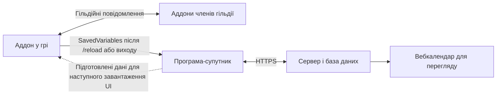

# Зовнішнє сховище гільдійних подій

**Статус: пропозиція для майбутньої розробки. Сервер, програма-супутник і вебкалендар не реалізовані.**

## Мета

Зберігати події, заявки, рішення автора та скасування поза клієнтами гравців, щоб гільдія могла переглядати їх поза грою та відновлювати після тривалої відсутності автора. Ігровий обмін через `OLDKRKN` залишається основним способом швидкого оновлення між персонажами онлайн.

## Запропонована схема

- **Аддон** створює події, надсилає заявки, показує рішення та синхронізує їх у грі. Він зберігає локальні дані через `OldKrakenDB`.
- **Програма-супутник** читає збережені файли після того, як гра їх записала, та надсилає дозволені дані на сервер. Вона також може отримувати дані для наступного завантаження інтерфейсу.
- **Сервер** зберігає події, версії, заявки та скасування, надає API й веде резервні копії.
- **Вебкалендар** спочатку призначений лише для перегляду. Редагування через сайт і повернення цих змін у гру — окремий майбутній етап.

Початковий варіант передбачає програму-супутник у кількох довірених членів гільдії, а не обов'язково в кожного гравця. Програма зможе завантажити лише ті дані, які її аддон уже отримав у грі.

## Обмеження синхронізації

Звичайний аддон WoW не звертається безпосередньо до вебсервера. Гра записує SavedVariables під час `/reload`, виходу з персонажа чи гри; дані завантажуються до аддона під час наступного завантаження UI. Тому зовнішній сервер не забезпечує автоматичну синхронізацію в реальному часі у вже відкритому ігровому інтерфейсі. Поведінку запису й завантаження потрібно підтвердити на WoW Forever 1.60.1, build 70938. Довідка: [Saved variables](https://warcraft.wiki.gg/wiki/Saved_variables), [WoW UI FAQ](https://warcraft.wiki.gg/wiki/UI_FAQ/AddOns).

Якщо всі власники програми-супутника були офлайн під час зміни, сервер дізнається про неї лише після того, як один із них отримає стан у грі та гра запише його SavedVariables. Якщо ні автор, ні учасник зі свіжою копією не підключаться, сервер не зможе вигадати відсутні дані.

Спосіб імпорту в гру ще потрібно дослідити. Не слід змінювати активний SavedVariables-файл під час роботи клієнта: гра може перезаписати зміни при виході. Варіант з окремим підготовленим файлом аддона має бути перевірений на реальному клієнті та потребуватиме повторного завантаження інтерфейсу.

## Дані й узгодження

Для кожної події потрібні стабільний ідентифікатор, гільдія та realm, автор, версія, час, опис, заявки зі статусами й запис про скасування. Сервер має обробляти повторне завантаження одних даних без дублювання, зберігати походження й час отримання та не відновлювати стару версію поверх новішої. Скасування потрібно зберігати як окремий стан достатньо довго, щоб застаріла копія не повернула скасовану подію.

Правила порівняння версій, строки зберігання, відновлення резервної копії та поведінку за суперечливих даних потрібно визначити до реалізації. Дані, отримані через іншого учасника гільдії, не мають автоматично вважатися криптографічно підтвердженими автором.

## Доступ та приватність

Вхід до сервера має обмежувати доступ до відповідної гільдії; змінювати подію повинні лише уповноважені користувачі. Ім'я персонажа всередині завантаженого файлу саме по собі не підтверджує особу. Доступні способи прив'язки акаунта до персонажа та перевірки членства саме у WoW Forever ще не перевірено.

Програма-супутник має надсилати лише необхідні для обраної функції дані, пояснювати користувачу, що саме передається, і зберігати облікові дані поза аддоном та репозиторієм. Адміністратору знадобляться резервне копіювання, відновлення й видалення даних, а також зрозумілі правила їх зберігання.

## Пропоновані етапи

1. Перевірити поведінку SavedVariables у цільовому клієнті й визначити формат експорту, не змінюючи поточний гільдійний транспорт.
2. Підготувати серверне резервне копіювання та програму-супутник для завантаження даних після `/reload` або виходу.
3. Додати вебкалендар лише для читання та перевірити авторизацію і відновлення даних.
4. Окремо дослідити імпорт на клієнт, конфлікти та права для редагування подій поза грою.

Технології та хостинг не обрано. Перед реалізацією потрібно оцінити експлуатацію, доступність, вартість і сумісність із WoW Forever.
